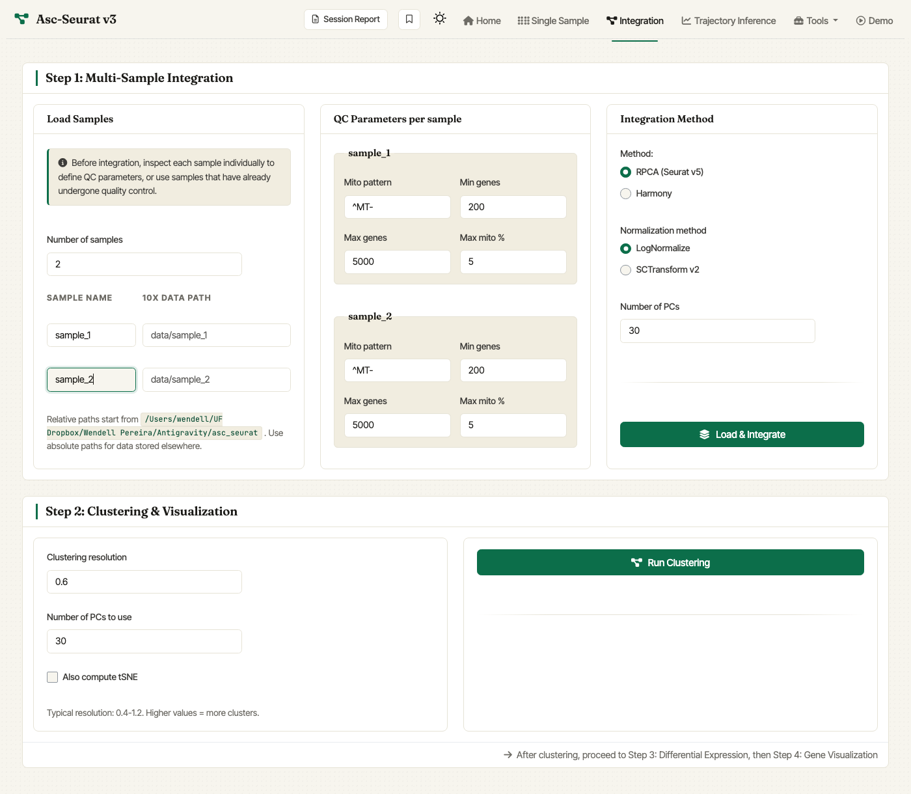

.. _loading_data_int:

****************************************************
Loading the data and integration of multiple samples
****************************************************

To analyze multiple samples, select the **Integration** tab in the web
application. The full integration workflow is contained in this tab:
sample declaration, per-sample QC, normalization, integration method,
clustering, and the integrated visualization handoff.

Integration uses Seurat v5's
`IntegrateLayers <https://satijalab.org/seurat/reference/integratelayers>`_
framework. **RPCA** is the default method and **Harmony** is also
available from the same tab. Samples are declared directly in the UI —
pick the number of samples, type their names and paths inline, and set
the QC values for each on the same page.

   Integration tab. Declare the number of samples and their paths in
   *Load Samples*, set per-sample QC in the middle column, and pick
   **RPCA (Seurat v5)** or **Harmony** in *Integration Method*.

Declaring the samples
=====================

In the *Load Samples* card:

#. Set **Number of samples** (1–24).
#. For each sample, fill in:

   - **Sample name** — any label you prefer. Use the same name for
     biological replicates that should be pooled in plots and analyses.
   - **10X data path** — relative or absolute path to the sample's
     directory.

Setting per-sample QC parameters
================================

In the *QC Parameters per sample* card, for each declared sample set:

- **Mito pattern** — regular expression matching mitochondrial gene IDs
  (default ``^MT-`` for human; use ``^mt-`` for mouse, ``^ATMG``
  for *Arabidopsis*, etc.).
- **Min genes** — minimum number of genes a cell must express to be
  retained.
- **Max genes** — maximum number of genes a cell can express
  (useful to filter suspected doublets).
- **Max mito %** — maximum percentage of mitochondrial transcripts
  allowed per cell.

Suggested thresholds use each sample's **Mito pattern**. Entering a new
data path suggests all three thresholds again; changing the pattern
suggests a new **Max mito %** unless you typed your own value.

Choosing the integration method
===============================

In the *Integration Method* card:

- **Method**: ``RPCA (Seurat v5)`` (default) or ``Harmony``.
- **Normalization method**: ``LogNormalize (faster)`` (default) or
  ``SCTransform v2``.
- **Number of PCs for integration**: principal components used by RPCA
  or Harmony (default ``30``; range 5–100). With Harmony, this is also
  the maximum number of PCs available for clustering. Values that are
  not whole numbers from 5 to 100 are refused with a warning.

Click **Load & Integrate** to run the integration. The integrated
object becomes available to the clustering, DE, and visualization
modules below. If a run fails (for example, because a sample path is
mistyped), the previous integration and everything computed from it
are kept, and a notification explains the failure.

Saving the integrated object for reuse
======================================

Integration is the most time-consuming step in this tab. After it
completes, an *Integration Summary* card reports the method,
normalization, and number of PCs used by the last successful run and
lets you download the integrated Seurat object as an RDS file. To skip the integration step
later, load that RDS in the **Single Sample** tab using *Existing
Seurat RDS* — the clustering and downstream steps will pick up from
there.
